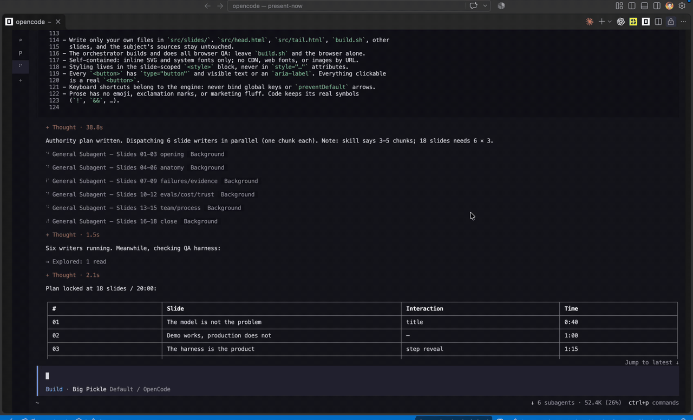

# present-now

An Agent Skill that makes a slide deck for a talk or a workshop.

You tell your coding agent what the talk is about. The agent asks you a few questions, plans
the slides, writes them, and checks every slide in a real browser. You get one HTML file. Open it
in a browser and present. You do not need PowerPoint or Keynote.

[](demo/parallel-agents.mp4)

Six helper agents write the slides at the same time. Click the picture for the full video.

**See a demo deck:** [open it in your browser](https://taimoorkhan1122.github.io/present-now/demo/deck.html). This deck
was made with this skill. Its source file is [`demo/deck.html`](demo/deck.html).

## For AI agents

You can let your agent do the install. Paste this into Claude Code (or another agent):

```
Install the present-now skill from https://github.com/Taimoorkhan1122/present-now.
Follow the "For AI agents" section of its README.md.
```

### Steps for the agent

<details>
<summary>Show the install steps</summary>

If you are an AI agent installing this skill, follow these steps in order.

1. **Check the requirements.** Run each command and note which ones fail:

   ```sh
   rg --version
   node --version              # needs v20 or newer
   chrome-devtools-axi --help
   ```

   Also check that Google Chrome is installed. If something is missing, show the user the
   install command from the Requirements table below. Install it only after the user says yes.
   Missing Node, Chrome, or `chrome-devtools-axi` does not block the install. It only turns off
   the browser check.

2. **Pick the install folder.** Use `~/.claude/skills/present-now` unless the user asks for
   one project only. For one project, use `.claude/skills/present-now` inside that project. If
   the folder already exists, stop and ask the user before you change it.

3. **Download the skill:**

   ```sh
   git clone --depth 1 https://github.com/Taimoorkhan1122/present-now <install-folder>
   chmod +x <install-folder>/scripts/*.sh <install-folder>/template/build.sh
   ```

4. **Test it.** Make a throwaway deck, check that the title was filled in, then delete it:

   ```sh
   <install-folder>/scripts/new.sh /tmp/present-now-check "Check" "Check"
   rg '__TITLE__|__FOOTER__' /tmp/present-now-check/src    # must print nothing
   rm -rf /tmp/present-now-check
   ```

5. **Report to the user.** Say where the skill is installed and which requirements are
   missing. Tell them to type `/present-now` to start. If it is not in the `/` menu, they should
   start a new session.

The install is done when `<install-folder>/SKILL.md` exists, the test in step 4 prints nothing,
and the user has your report.

To make a deck after the install, read `<install-folder>/SKILL.md` and follow it.

</details>

## What you get

- **One file.** `deck.html` has everything inside it. It works offline. You can email it or put it
  on a USB stick.
- **Fits any screen.** Slides are drawn at 1600×900 and scale to fit the window.
- **Interactive slides.** Tabs, before/after views, step-by-step reveals, and clickable maps.
- **Speaker notes.** Each slide has notes with a time. Press `N` to see them, or `P` to open a
  separate presenter window.
- **Progress bar** and slide counter.
- **Clicker-safe.** A presentation clicker (arrow keys, Page Up, Page Down) works.
- **Five themes.** Editorial (default), Terminal, Swiss, Midnight, and Sage, or your own brand
  color.

## How it works

The skill follows seven steps:

1. **Interview.** The agent asks up to 8 short questions: who is listening, the one thing they
   should remember, what must be on screen, how long the talk is, and how it should look.
2. **Read.** The agent reads your subject (a code repo, documents, or notes) just enough to plan.
3. **Plan.** The agent shows you a table of slides, with times that add up to your time limit.
   You say OK.
4. **Set up.** A script copies the deck template into a new folder.
5. **Write.** Several helper agents write the slides at the same time. Each one writes 2 or 3
   slides.
6. **Check.** A script opens every slide in Chrome, takes a screenshot, clicks every button, and
   reports anything that falls off the slide. The agent fixes problems and checks again.
7. **Hand-off.** The deck opens in your browser. The agent tells you what it made and what it
   could not check.

## Requirements

You need these before you install:

| What | Why | How to get it |
|---|---|---|
| [Claude Code](https://claude.com/claude-code) | Runs the skill. The interview and the parallel helper agents use Claude Code tools. | See the Claude Code docs. |
| macOS or Linux | The scripts use `sh`, `sed`, and `cp`. | Built in. On Windows, use WSL (not tested). |
| `rg` (ripgrep) | Checks that the template has no empty placeholders left. | `brew install ripgrep` or `apt install ripgrep` |
| Google Chrome | The check step opens slides in Chrome. | [google.com/chrome](https://www.google.com/chrome/) |
| Node.js 20 or newer | Runs `chrome-devtools-axi`. | [nodejs.org](https://nodejs.org/) |
| [`chrome-devtools-axi`](https://github.com/kunchenguid/chrome-devtools-axi) | Lets the check script control Chrome. | `npm install -g chrome-devtools-axi` |

Check that the tools are ready:

```sh
rg --version
node --version              # must be 20 or newer
chrome-devtools-axi --help
```

The last three rows are only for step 6 (the browser check). Without them, the skill can still
write the deck, but no one checks the slides. You must then look at every slide yourself.

Other agents that read `SKILL.md` files (the [Agent Skills](https://agentskills.io) format) can
load this skill too. They may not have the question tool or helper agents, so steps 1 and 5 can
work differently. Only Claude Code is tested.

## Install

Pick one way.

**For all your projects** (most people want this):

```sh
git clone https://github.com/Taimoorkhan1122/present-now ~/.claude/skills/present-now
```

**For one project only.** Run this inside the project folder:

```sh
git clone https://github.com/Taimoorkhan1122/present-now .claude/skills/present-now
```

**Keep it somewhere else, and link it.** Use this if you want to edit the skill in its own
folder:

```sh
git clone https://github.com/Taimoorkhan1122/present-now ~/present-now
ln -s ~/present-now ~/.claude/skills/present-now
```

Then make the scripts runnable:

```sh
chmod +x ~/.claude/skills/present-now/scripts/*.sh ~/.claude/skills/present-now/template/build.sh
```

To check the install, start a new Claude Code session and type `/`. You should see
`present-now` in the list.

To update later, run `git pull` in the skill folder.

## Use

Start Claude Code and type `/present-now`, then describe your talk in one line:

```
/present-now a 10 minute talk about this repo for our frontend team
```

You can also just ask in plain words. The agent picks the skill on its own:

```
Make me slides for a 15 minute workshop on our API design rules.
```

Then:

1. Answer the questions. Pick an option, or type your own answer.
2. Read the slide plan. Say OK, or ask for changes.
3. Wait while the slides are written and checked. This takes a few minutes.
4. The deck opens in your browser.

If you want to skip the questions, say "go". The agent uses defaults for anything you did not
answer, and tells you which defaults it used.

By default the deck goes in `~/presentations/<talk-name>/`. This keeps it out of your code repo.

## Present

Open `deck.html` in any modern browser.

| Key | What it does |
|---|---|
| `→` `↓` `Space` `Page Down` | Next step or next slide |
| `←` `↑` `Page Up` | Previous slide |
| `Home` / `End` | First / last slide |
| `N` | Show or hide speaker notes on the slide |
| `P` | Open the presenter window (slide number, notes, next slide title) |
| `F` | Full screen |

Tips:

- When you share your screen or mirror it to a projector, hide the notes (`N`). Use the
  presenter window (`P`) on your own screen.
- The slide number is in the web address. If you reload the page, you stay on the same slide.

## Change a deck later

Each slide is its own file in `src/slides/`. To change a slide:

1. Edit `src/slides/NN-name.html`.
2. Run `./build.sh` in the deck folder. This makes a new `deck.html`.
3. Reload the browser.

You can also ask your agent: "On slide 4, make the headline shorter."

To check every slide again:

```sh
~/.claude/skills/present-now/scripts/qa.sh ~/presentations/<talk-name>/deck.html
```

Screenshots go to `/tmp/present-now-qa/`. Do not use Chrome for anything else while this runs.

## Change the look

In the interview, the agent asks you to pick a theme. It suggests the one that fits your
audience best.

| Theme | Look | Good for |
|---|---|---|
| **Editorial** (default) | Warm off-white, serif headings, orange accent | Most talks |
| **Terminal** | Near-black, sans headings, orange accent | Developer talks, live coding, dark rooms |
| **Swiss** | Pure white, bold sans headings, blue accent | Product and engineering reviews, bright rooms, weak projectors |
| **Midnight** | Deep navy, serif headings, gold accent | Keynotes, conference stages, evening events |
| **Sage** | Soft green-grey, serif headings, teal accent | Workshops, onboarding, non-technical audiences |

You can also give a **brand color** (for example `#0055ff`). The agent puts it on top of the
closest theme. If your repo has design tokens, the agent can take the color from there.

The theme files are in `themes/`. How the agent picks and asks is in `references/themes.md`.

## What is inside

```
present-now/
├── SKILL.md              The steps the agent follows
├── scripts/
│   ├── new.sh            Makes a new deck folder from the template
│   └── qa.sh             Checks every slide in Chrome
├── themes/               Terminal, Swiss, Midnight, and Sage colors
├── references/
│   └── themes.md         How the agent offers themes, and brand colors
└── template/             Copied into every new deck
    ├── AUTHORING.md      Rules every slide writer follows
    ├── build.sh          Joins the slide files into deck.html
    └── src/
        ├── head.html     All the styles
        └── tail.html     The slide engine (keys, notes, presenter window)
```

A finished deck folder looks like this:

```
~/presentations/my-talk/
├── deck.html             Present this file
├── build.sh
├── AUTHORING.md
└── src/
    ├── head.html
    ├── tail.html
    └── slides/
        ├── 01-title.html
        ├── 02-problem.html
        └── ...
```

## Known limits

- The deck uses system fonts. On Windows and Linux, the serif headings fall back to Georgia.
- At the end, the agent opens the deck with the macOS `open` command. On Linux, open
  `deck.html` yourself, or use `xdg-open`.
- `qa.sh` controls one shared Chrome window. Run it alone, or the screenshots can come out at
  the wrong size.
- Videos are not packed into the file. If a slide plays a video, keep the video file next to
  `deck.html`.

## Contributing

Issues and pull requests are welcome. Please keep the deck to one self-contained HTML file with
no outside downloads, and run `scripts/qa.sh` on a sample deck before you send a change.

## License

[MIT](LICENSE)
